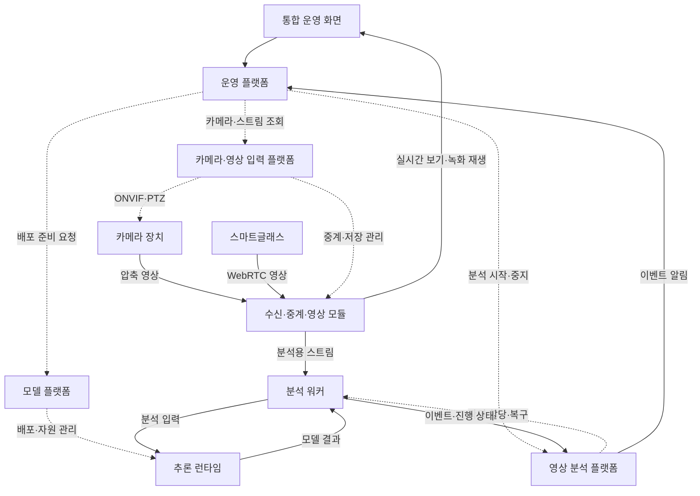
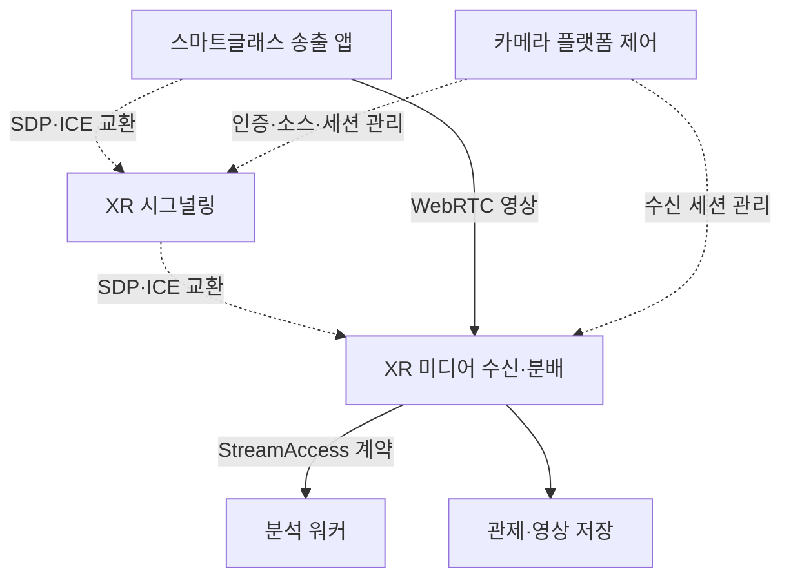
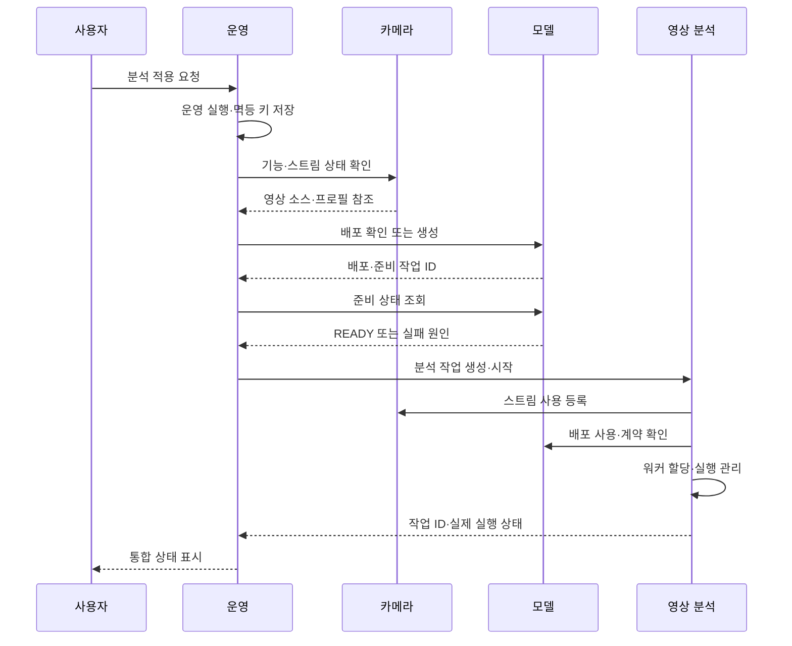
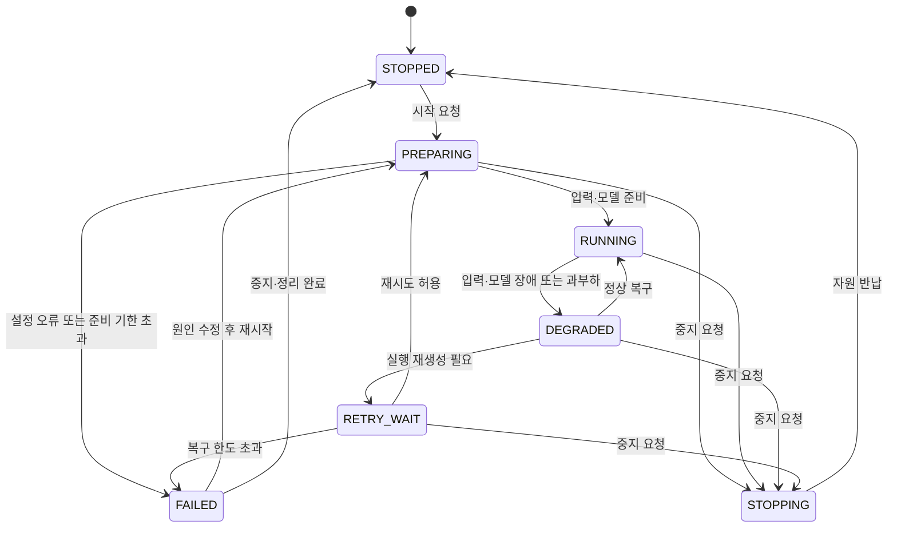

# VMS 플랫폼 아키텍처 및 개발 계획

작성일·수정일: 2026-09-29 · 상태: 실행 기준 v0.4 · 변경: 사용자 지정 프로젝트 구조 채택, P0-A HTTP 실행 기반 착수·검증 범위 구분

이 문서는 대화에서 합의한 요구사항을 구현 계획으로 정리한 것이다. 작업 단계와 성능 수치는 계획·검증 목표이며 구현 완료나 실측 결과를 의미하지 않는다. 기간 단축보다 요구 충족·안정성·운영 효율·유지보수성을 우선한다. 기존 소스와 대상 서버의 배포 환경은 변경하지 않았다. 별도 새 프로젝트 패키지에서 P0-A 실행 기반을 구현했으며, 해당 상태는 16절에 구분해 기록한다.

## 1. 목표와 계획의 전제

목표는 카메라, 모델, 영상 분석, 운영을 독립된 플랫폼으로 구성하고 API를 통해 연결하는 VMS다. 카메라는 촬영·인코딩·영상 제공·지원되는 PTZ를 담당하며, 서버에서 모델을 배포하고 영상 소스별 분석 작업을 실행한다. 사용자에게는 영상 소스 등록 → 모델 준비 → 분석 적용 → 관제·결과 확인의 흐름을 제공한다. 카메라 플랫폼은 CCTV와 스마트글래스의 영상 입력을 함께 관리하며, 내부 공통 자원은 VideoSource로 일반화한다. ONVIF는 CCTV 입력 어댑터의 기능이고 모든 장치의 필수 조건은 아니다.

| 구분 | 계획 기준 |
|---|---|
| 핵심 플랫폼 | 카메라 / 모델 / 영상 분석 / 운영의 네 플랫폼 |
| 영상 저장·재생 | 초기에는 카메라 플랫폼의 독립 모듈·서비스. 장기 녹화·검색 요구 확대 시 별도 플랫폼으로 분리 |
| 모델 플랫폼 | Management / Deployment / Training 책임 구분과 독립성 유지. 기존 구현 연동·부분 재구현·필요한 내부 재설계를 비교하고 변경은 모델 플랫폼의 범위에서 수행 |
| 초기 실행 환경 | 개발·검증용 GPU 서버 1대, Docker Compose를 첫 검증 환경으로 사용. OS·CPU 아키텍처·GPU는 P0에서 확인 |
| 최소 통합 검증 구성 | CCTV 2대 + 실제 스마트글래스 1대, 모델 종류 2개, 영상 소스-모델 다대다 연결. 다중 XR 식별은 실제 장비와 보조 송출 클라이언트로 추가 검증 |
| MVP 분석 기능 | CCTV: 사람 검출 기반 ROI 침입·포즈 기반 쓰러짐. XR: 일반 객체 검출 결과와 근거 스냅샷·클립을 관제 화면에서 확인 |
| XR 앱 개발 | 기존 스마트글래스/Unity 앱은 참고·비교 대상. 장치 SDK·카메라 권한·하드웨어 인코더·배터리·발열에 맞춰 수정·부분 교체·신규 개발 모두 허용 |
| 재사용 원칙 | 기존 코드·언어·시그널링 규격을 반드시 유지하지 않는다. 기능 요구·학습된 교훈·확인된 결함을 설계 근거로 활용 |
| 기술 선택 | Go 우선 검토 영역과 장치·미디어·AI 전용 영역을 구분. 성능 실측과 운영 복잡도·디버깅·유지보수 비용으로 결정 |
| 진행 기준 | 주차·고정 종료일 대신 선행 조건과 완료 기준으로 진행. v0.2의 15~18주 추정은 현재 일정 제약으로 사용하지 않음 |
| 추가 기능 | PPE·화재·방치물, VLM 설명은 기본 데이터·분석·저장 경로 안정화 후 진행 |
| 별도 제품 범위 | 신규 모델 학습, 전 제조사·전 스마트글래스 호환, 다중 서버 HA, 상용 운영 인증, 안경 AR 표시·착용자 자신의 쓰러짐 판단은 별도 요구·평가 기준 필요 |

자료 근거는 `samsung_poc_ver1_only_code.tar`, `samsung_poc_ver3_onvif.tar`, `삼성전자PoC 개선방안_ver4.pptx`와 기존 비교 분석 보고서다. agent_project 최신 코드·API 및 실제 장비 상태는 P0에서 확인한다. API 경계와 데이터 소유권을 보존하면서 기존 구현을 유지할지 교체할지 결정한다. 재사용 불가를 이유로 목표 구조를 축소하지 않는다.

### 1.1 변경 이력과 적용 원칙

- v0.2: CCTV·XR 공통 VideoSource·Device·SourceSession, XR 수신·재접속·실장비 검증을 MVP에 포함했다.
- v0.3: 기간보다 품질·운영 효율·유지보수성을 우선하고, 기존 서버·스마트글래스 앱 재사용을 필수 조건에서 제거했다.
- v0.4: 사용자 지정 `src/platform`·`src/infra`·루트 `docs` 구조를 작업 기준으로 채택했다. P0-A의 네 Go API와 소스·작업 입력 검증 기반을 별도 패키지에서 구현했다.
- 서버·장치 앱·미디어 처리·AI 실행의 기술 선택을 분리한다. Go·Python·C#/Kotlin·네이티브 미디어 엔진 등을 역할에 맞게 비교한다.
- 구현은 기능별로 검증한 뒤 선택한다. 구현체 교체 시에도 네 플랫폼의 책임과 공통 소스·세션·분석 계약은 유지한다.
- 단계 완료 기준을 통과하면 다음 단계로 진행한다. 기존 주차·일수 표는 단계·의존성·인수 기준 표로 대체했다.
- 현재 수정 대상은 계획 문서와 새 프로젝트 패키지다. 기존 운영 서비스나 스마트글래스 앱을 교체한 상태가 아니다.

### 1.2 프로젝트 경로와 폴더 작업 기준 — 채택

사용자가 제안한 구조는 타당하므로 이후 작업 기준으로 채택한다. 목표 경로는 `/home/shshin/workspace/vms_project`다. 구현 위치와 문서 위치를 나누고, 제품 기능과 공용 인프라의 책임을 구분한다. 독립성은 폴더 구분뿐 아니라 데이터 소유권·API·별도 실행 경계로 보장한다.

| 위치 | 작업 기준 |
|---|---|
| `src/platform/camera` | 장치·소스·세션, ONVIF/PTZ, RTSP/XR 입력, 초기 녹화 모듈 |
| `src/platform/model` | 모델 등록·버전·배포·학습 및 런타임 소유 |
| `src/platform/analysis` | 분석 작업·실행·워커·추적·이벤트 |
| `src/platform/operation` | 운영 API·관제 UI·알림·플랫폼 간 업무 조율 |
| `src/platform/internal` | 초기 Go API의 공통 기술 코드. 업무 엔티티·공유 상태는 배치하지 않음 |
| `src/infra` | 공용 인프라 설정, 설치·검증·배포 보조·운영 도구 |
| 루트 `docs` | 요구·설계·ADR·계약 설명·운영 절차·작업 이력 |
| 루트 구성 파일 | README·AGENTS·Makefile·Compose·환경 예제·패키지 메타데이터 |
| 루트 `build`, `var` | 생성 바이너리와 로컬 실행 데이터. 버전 관리 제외 |

플랫폼별 소스·테스트·API 명세·입력 예제·Dockerfile·단독 Compose는 소유 플랫폼 아래 둔다. 공통 인프라는 `src/infra`, 전체 조합 진입점은 루트 Compose에 둔다. 다른 플랫폼의 `internal` 코드나 DB에 직접 접근하지 않는다. Go 외 언어의 코드도 해당 기능의 소유 플랫폼 아래 둔다.

초기 저장소는 단일 Go 모듈과 플랫폼별 실행 파일로 시작한다. 독립 릴리스·의존성 요구가 커지면 모듈·저장소를 나눌 수 있다. 폴더 구조·소유권·기술 선택 변경은 ADR로, 실제 변경·검증·미완료 항목은 작업 이력으로 기록한다. 세부 기준은 프로젝트의 `AGENTS.md`와 `docs/development/working-standards.md`가 담당한다.

## 2. 요구사항과 단계 연결

| ID | 요구사항 | 담당 | 최초 완료 단계 |
|---|---|---|---|
| R01 | 각 플랫폼은 자기 데이터·실행 상태를 소유하고 API로 연동 | 전체 | P0 계약, 전 단계 적용 |
| R02 | ONVIF 및 수동 RTSP 카메라 동적 등록·수정·삭제 | 카메라 | P1 |
| R03 | 실제 기능에 따른 PTZ·스트림 프로필, 재생·재연결 | 카메라 | P1 |
| R04 | 비전 모델의 버전 등록·배포·준비 상태·추론 | 모델 | P2 |
| R05 | 한 영상 소스의 여러 분석, CCTV·XR 소스의 동일 모델 배포 공유 | 영상 분석 + 모델 | P4 |
| R06 | 템플릿·설정·실행 상태를 갖는 분석 작업 | 영상 분석 | P3 |
| R07 | 영상 소스·세션·객체별 추적, 시간 조건과 이벤트 생성. 이동 시점의 템플릿 적용 조건 검증 | 영상 분석 | P3~P4 |
| R08 | 프레임·추론 결과·이벤트·영상의 시간 연결 | 카메라 + 영상 분석 | P3~P4, P6 통합 검증 |
| R09 | 이벤트 전후 영상·수동 요청 클립, 저장 상태, 조회·재생·보존 정책 | 카메라의 영상 모듈 | P4 |
| R10 | CCTV·XR 영상 소스와 모델·분석을 연결하는 운영 시나리오 | 운영 | P5 |
| R11 | 부분 실패·재시작 복구, 멱등 처리, 공유 자원 보호 | 각 소유 플랫폼 | 각 단계에 포함, P6 종합 검증 |
| R12 | 인증·권한·감사, 최소 계측·장애 원인 표시 | 전체 | P0 기반, 각 단계 구현 |
| R13 | 플랫폼별 빌드·실행·API 테스트, 통합 실행 구성 | 전체 | P0 계약·P0-T 골격, 각 구현 단계·P6 인수 |
| R14 | Device·VideoSource·SourceSession 분리, 지원 기능 기반 입력 계약 | 카메라 | P0 설계, P1·P1-XR 구현 |
| R15 | XR 인증·시그널링·WebRTC 수신·특정 장치 선택·재접속 | 카메라 | P1-XR |
| R16 | XR 프레임·시각·방향 정보 보존, 공통 모델 추론·결과 만료·클립 | 카메라 + 영상 분석 | P1-XR 입력, P3~P4 분석·영상 |
| R17 | 실제 스마트글래스와 외부망·TURN 경로, 다중 송출자 격리 검증 | 카메라 + 운영 | P1-XR 연결, P6 종합 검증 |
| R18 | 기존 구현 재사용·재구현 및 역할별 언어·런타임을 근거로 선택 | 전체 | P0-T 결정, 각 단계 검증 |
| R19 | 필요 시 실제 장치 SDK에 맞는 스마트글래스 송출 앱 신규 개발 | 카메라 입력·장치 앱 | P0-T 선택, P1-XR 구현·인수 |
| R20 | 구현은 `src/platform`·`src/infra`, 문서는 루트 `docs`에 배치하고 작업 기준을 지속 기록 | 전체 | P0-A부터 전 단계 적용 |

사용자가 제안한 플랫폼 분리 원칙을 유지한다. 독립 플랫폼은 독립된 책임과 계약을 뜻하며, 각 플랫폼에 서버·DB 서버·웹 앱을 한 대씩 배정한다는 뜻은 아니다. 서비스 경계는 데이터 소유권과 독립적 변경·배포 가능성을 기준으로 잡는다.[S1]

## 3. 플랫폼별 소유권

| 플랫폼 | 소유 기능·데이터 | 다른 플랫폼과의 경계 |
|---|---|---|
| 카메라 | Device·VideoSource·SourceSession, ONVIF/RTSP/WebRTC 어댑터, XR 시그널링·미디어 수신·분배, 자격증명, 프로필·capabilities | 영상 접근 정보와 장치 기능을 제공. PTZ는 지원 장치에만 제공. 모델 종류와 탐지 규칙을 소유하지 않음 |
| 카메라의 영상 모듈 | 원본 세그먼트·클립·저장 작업·보존 정책·재생 정보 | source_id·시간 구간·요청 ID를 받아 영상을 생성. event_id는 이벤트 관련 요청에만 참조하며 사건 판단을 소유하지 않음 |
| 모델 | 모델·버전·아티팩트, 실행 규격, 배포·추론 런타임, 모델 GPU 할당 | 모델 실행과 입력·출력 계약을 제공. 카메라 비밀번호·영상 소스별 추적 상태를 소유하지 않음 |
| 영상 분석 | 템플릿 버전, 영상 소스와 배포를 참조하는 분석 작업, 워커 할당, 추적·시간 규칙, 탐지 이벤트 | 입력 유형과 템플릿 적용 조건을 검증. 모델 API·영상 API를 사용하며 XR 연결·모델 컨테이너를 직접 관리하지 않음 |
| 운영 | 운영 시나리오·실행 스케줄, 플랫폼 간 실행 조율, 통합 상태 조회, 알림·운영자 확인·조치 | 플랫폼 API를 사용. 카메라·모델·분석 워커를 직접 재시작하지 않음 |

탐지 이벤트의 원본은 분석 플랫폼에, 운영자의 확인·조치 기록은 운영 플랫폼에 둔다. 운영 화면용 조회 복제본은 갱신 시각과 원본 ID를 갖는 읽기 모델로 취급한다. 분석 설정과 실행 상태를 운영 DB에 별도 원본으로 만들지 않는다.

영상 모듈의 테이블·객체 경로·API는 카메라 장치 관리와 처음부터 구분한다. 장치 삭제는 녹화 영상 삭제와 별도 작업이다. 영상 관리 플랫폼을 추후 추출할 때 이 경계와 기존 ID를 유지한다.

## 4. 논리 아키텍처

아래 실선은 주로 데이터 흐름, 점선은 제어·조회다. 분석 워커와 추론 런타임은 각각 영상 분석 플랫폼과 모델 플랫폼의 실행 구성요소다.

운영 API는 원본 영상이나 매 프레임의 추론 데이터를 중계하지 않는다. 워커는 카메라 플랫폼이 제공한 중계 스트림에 접근하고, 준비된 모델 런타임에 직접 요청한다. 브라우저도 권한이 적용된 미디어 경로로 영상을 받는다.

동일 노드에서 동일 영상 소스·프로필을 사용하는 분석은 가능하면 디코딩을 공유한다. 서로 다른 노드나 다른 프로필은 별도의 디코딩이 필요할 수 있다. 영상 소스마다 분석 워커·모델 컨테이너를 무조건 하나씩 생성하는 방식은 기본 규칙으로 삼지 않는다.

### 4.1 XR 입력 경로

XR 시그널링과 수신·분배는 카메라 플랫폼의 구성요소다. 시그널링 WebSocket이 영상 프레임을 전달한다고 가정하지 않는다. 실제 미디어는 WebRTC 연결로 전송되며 네트워크 조건에 따라 TURN을 경유할 수 있다.[S8]

분석·관제·녹화 소비자는 서버 수신 계층을 공유하도록 한다. 동일 XR 소스·프로필의 소비자 증가가 장치의 PeerConnection 증가로 이어지지 않도록 구독을 관리한다. 디코딩된 프레임 공유, 압축 미디어 전달, 재인코딩 여부는 수신 구현에 맞춰 P1-XR에 검증한다. 서버에서 분배한다는 사실만으로 zero-copy나 무재인코딩을 보장하지 않는다.

`StreamAccess`는 접근 프로토콜과 필요한 접속 정보를 명시한다. CCTV의 RTSP와 XR의 WebRTC 또는 로컬 수신 연결을 같은 영상 소스 계약 아래 제공한다. 모든 XR 입력을 RTSP로 재변환하도록 강제하지 않으며, 기존 맞춤 시그널링을 go2rtc가 그대로 이해한다고 가정하지 않는다.

## 5. 기술 선택과 재사용·재구현 판단

아래는 우선 검토안이다. P0-T의 핵심 경로 검증 후 결정 기록(ADR)에 채택 근거·측정 결과·한계를 남긴다. 언어를 한 가지로 통일하거나 기존 코드를 최대한 보존하는 것을 목표로 삼지 않는다.

| 영역 | 우선 검토안 | 선택 근거·확인할 점 |
|---|---|---|
| 카메라·영상 분석·운영의 관리 API·제어 루프 | Go | 연결·작업·lease·취소·상태 관리의 일관성. 기존 Python API도 비교 대상이며 성능 향상을 미리 보장하지 않음 |
| ONVIF 어댑터 | Go 구현과 기존 Python 어댑터 비교 | 실제 장치 discovery·미디어·PTZ·인증·timeout 호환성을 우선. Python 유지가 합리적이면 좁은 어댑터로 분리 |
| XR 시그널링·세션 제어 | Go 기반 신규 구현 우선 검토 | 인증·영구 ID·세션·명시적 대상 지정·복구 계약을 새 구조에 맞춤. 기존 Node.js는 프로토콜·행동 참고 자료 |
| XR 서버 미디어 수신·분배 | Go/Pion을 우선 검증, aiortc·기존 미디어 엔진 경로와 비교 | RTP/RTCP·ICE·TURN·트랙·세션·분배와 디코더/녹화 연동 확인. 웹소켓만 바꿔 전체 병목이 해결된다고 가정하지 않음 |
| 스마트글래스 송출 앱 | 장치 SDK에 적합한 기술로 수정 또는 신규 개발 | Unity/C#·Android Kotlin/Java·제조사 네이티브 SDK 등을 조건부 비교. 서버 언어와 통일할 의무 없음 |
| 디코딩·인코딩·녹화 | FFmpeg/GStreamer 등 검증된 엔진 사용 우선 | PTS·코덱·GPU 가속·버퍼·CPU/GPU 전송 경로를 검증. 표준 코덱을 직접 다시 만드는 것은 기본 방향이 아님 |
| 영상 중계 | go2rtc 등 기존 엔진의 API·안정성·XR 연동 평가 | 기능이 맞으면 채택. 플랫폼의 장치·권한·복구 정책을 엔진 내부 설정에 과도하게 결합하지 않음 |
| 모델 플랫폼 | 기존 구조·API의 적합성 확인 후 연동·내부 개선·교체 선택 | 모델·버전·배포·학습 소유권 유지. 비전 작업 규격을 제공하고 카메라별 상태는 분석 플랫폼에서 관리 |
| 추론 런타임 | Python 모델 어댑터와 적합한 전용 런타임 비교 | 모델 지원·출력 일치·GPU 메모리·처리량·지연·운영 난이도 평가. ONNX/TensorRT/Triton 등은 모델 호환 조건 충족 시 후보 |
| 분석 알고리즘·워커 | Python/네이티브 라이브러리 우선 검토, 필요 시 Go·Rust·C++ 일부 적용 | 추적·규칙의 정확성과 프레임 처리 비용 측정. 관리 API와 실행 프로세스는 분리 |
| 외부/내부 API | 외부 REST/OpenAPI, 내부 제어 gRPC 우선 | 같은 호스트 UDS·다른 호스트 TCP를 구분. 기존 API 연결과 신규 계약의 버전·이행 계획 작성 |
| 영속 데이터·객체 | PostgreSQL과 객체 저장소를 기준 후보로 유지 | 플랫폼별 DB·계정·접근 범위 분리. 기존 스키마·클라이언트 코드는 변경 가능 |
| 비동기 처리 | 영속 작업·outbox·멱등 소비 계약 우선 | DB 기반 전달과 기존 Kafka 사용을 처리량·운영 부담으로 선택. 도구 변경에도 전달·중복 제거 계약 유지 |
| 배포·관측 | 플랫폼별 이미지/Compose와 상위 통합, 구조화 로그·상태·최소 메트릭 | 기능 검증 초기부터 계측. 다중 노드가 필요해질 때 배포 실행기를 확장 |

Pion은 Go로 구현된 WebRTC 라이브러리이며 RTP/RTCP 접근과 FFmpeg/GStreamer 등의 미디어 도구 연동을 제공한다.[S10] 이번 프로젝트의 디코딩·영상 저장·GPU 추론까지 자동으로 제공하거나 aiortc보다 빠르다는 의미는 아니다. 해당 구간의 연동과 비용은 별도로 측정한다.

### 5.1 서버와 스마트글래스 앱의 선택 구분

기존 `xr_signaling_server`는 서버 프로그램이고, 스마트글래스에서 카메라를 열어 영상을 보내는 앱은 별도의 실행 프로그램이다. 두 구성요소는 공통 시그널링·인증·미디어 계약으로 연결되며 구현 언어는 달라도 된다.

| 장치 조건 | 앱 기술 검토 방향 | 먼저 확인할 내용 |
|---|---|---|
| 제조사가 Unity 연동 SDK를 제공하고 해당 기능이 필요 | Unity/C# 또는 SDK 권장 구성 | 실제 글래스·OS·패키지 버전 지원, 카메라 프레임 접근, 하드웨어 인코딩, 앱 lifecycle |
| Android 네이티브 카메라 API·제조사 SDK 접근 가능 | Kotlin/Java + 적합한 WebRTC/인코더 연동 | CameraX/Camera2 또는 SDK의 접근 범위, 백그라운드·권한·화면 꺼짐 동작 |
| 제조사 전용 네이티브 SDK 의존 | 해당 SDK가 지원하는 언어·바인딩 | 프레임/압축 영상 제공 형식, timestamp·회전 정보, 드라이버·CPU 아키텍처 |
| Go로 장치 앱 일부를 구현하려는 경우 | SDK·카메라·인코더 연결 비용을 먼저 검증 | 브리지·바인딩·복사·앱 수명주기까지 평가. Go 서버 선택을 장치 앱의 Go 선택 근거로 대신하지 않음 |

Unity의 WebRTC 패키지는 플랫폼 지원 요구를 확인해야 하며, Android 카메라 API도 장치 구성과 접근 방식에 따른 검토가 필요하다.[S11][S12] 현재 스마트글래스 모델·OS·SDK가 확정되지 않았으므로 앱 언어는 아직 확정하지 않는다.

### 5.2 기술 검증과 결정 기준

1. 실제 지원할 장비·코덱·해상도·FPS와 API·기능 요구를 고정한다. 필요한 송출 앱을 새로 만들 수 있도록 최소 캡처→인코딩→전송 경로를 검증 범위에 둔다.
2. 핵심 불확실성이 있는 구간에 한해 유력 후보를 비교한다. 예: XR Go/Pion 수신 경로와 aiortc 기준 경로. 모든 언어·프레임워크를 끝없이 구현해 비교하지 않는다.
3. 동일 입력·모델·부하 조건에서 연결 성공·재접속·프레임 유실·PTS 일치·취소·종료를 먼저 검증한다.
4. 그다음 p50/p95 지연, CPU/RAM/VRAM, 디코드·인코드 횟수, 메모리 복사·CPU/GPU 전송, GPU 처리량을 기록한다. 장치에서는 배터리·발열·연속 송출 시간도 측정한다.
5. 배포 구성 수, 네이티브 의존성, 로그·디버깅, 호환성 테스트, 변경 시 영향 범위를 평가한다. 성능과 기능이 비슷하면 운영·유지보수가 단순한 구성을 우선한다.
6. 채택 근거와 남은 한계를 ADR로 기록한다. 최소 수용 기준을 만족한 후보가 정해지면 선택을 확정하고 다음 단계로 진행한다.

성능 차이가 확인되지 않아도 구조·보안·복구·유지보수 측면의 근거가 충분하면 재구현할 수 있다. 반대로 기존 구현이 요구와 품질 기준을 만족하면 채택할 수 있다. 기간 제약 완화가 근거 없는 전면 재작성이나 자체 코덱 개발을 의미하지는 않는다.

### 5.3 공통 계약과 교체 가능성

모델별 전처리·후처리 정의는 모델 버전이 소유하고 실행 위치는 선택한 런타임 구조에 맞춘다. 워커는 원본 크기·ROI·회전 변환을 유지하고 이중 전처리를 방지한다. 같은 호스트에서 워커와 추론 런타임을 함께 실행할 수 있으며, 모델 자원과 디코더 자원의 예산을 함께 산정한다.

Rust·공유메모리·Zenoh와 NVIDIA 중심의 DeepStream/Triton도 요구에 맞는 구간에서 검토한다.[S6][S7] 목표 장비의 미디어·추론 경로에서 먼저 복사·재인코딩·큐 지연을 측정하고 도입 여부를 결정한다. 독립 플랫폼의 데이터 소유권·입출력 규격은 런타임 선택과 분리한다.

## 6. 자원과 API 계약 초안

이 절의 이름·필드는 전체 목표 설계다. P0-A에서 소스·분석 작업의 입력 검증 계약 일부만 구현했으며, 실제 저장·세션·프레임·실행 API가 모두 존재한다는 의미는 아니다. P0~P0-T에서 기존 계약과 대조하고 선택한 구현 방식에 맞춰 확정한다.

| 자원 | 소유자 | 핵심 필드·규칙 |
|---|---|---|
| Device | 카메라 | device_id, device_kind=CCTV/SMART_GLASSES 등, 등록·인증 정보, capabilities. 영구 ID를 IP나 접속 번호로 대체하지 않음 |
| VideoSource / StreamProfile | 카메라 | source_id, device_id, 채널, stream_profile_id, transport=RTSP/WEBRTC, input_mode=PULL/PUSH, motion_mode=FIXED/MOVING/UNKNOWN. 장치 하나에 여러 소스 허용 |
| SourceSession | 카메라 | source_session_id, source_id, stream_profile_id, publisher_id, session_epoch, track 정보, 연결·마지막 프레임 상태. 재접속 시 새 세션 |
| SourceCapability | 카메라 | supports_ptz·지원 프로필·영상 방향 등 기능. ONVIF·PTZ 미지원 입력도 등록 가능 |
| StreamAccess | 카메라 | source_id, stream_profile_id, access_protocol, 수신·중계 접근 정보, 접근 범위·만료. 실제 세션은 수신 상태·프레임 메타데이터로 확인. 장치 원본 자격증명 비노출 |
| ModelVersion | 모델 | model_version_id, task_type, artifact_digest, runtime_profile, 입력·출력·전처리·후처리 규격, 클래스·키포인트 규격 |
| Deployment | 모델 | deployment_id, model_version_id, desired/observed state, endpoint, node 정보, 준비 상태, 오류 |
| TemplateVersion | 영상 분석 | template_version_id, 분석 단계, 모델별 요구 task, tracker/rule 버전, 설정 스키마, supported_motion_modes, requires_static_view·requires_body_visibility 등 적용 조건 |
| AnalysisJob | 영상 분석 | analysis_job_id, source_id, stream_profile_id, template_version_id, 역할별 deployment_refs, fps·ROI·시간 설정, desired_state, generation |
| AnalysisRun | 영상 분석 | run_id, job_id, applied_generation, worker_id, lease_epoch, observed_state, heartbeat, failure_reason |
| DetectionEvent | 영상 분석 | event_id, job/run/source/session/track ID, rule/template/model 버전, 시간 구간, 상태·종료 사유, evidence 참조 |
| Recording / Clip | 영상 모듈 | recording_id, source_id, source_session_id, request_id, 선택적 event_id, 실제 저장 구간, 객체 참조, 보존 정책, 준비·실패·만료 상태 |
| OperationRun | 운영 | operation_run_id, 대상·요청, 각 플랫폼 operation/job ID, 단계 상태, retry·deadline, 공유 자원 사용 정보 |
| IncidentAction | 운영 | event_id 참조, 확인·조치 내용, 사용자·시각, 알림 이력 |

장치(Device)는 물리적 장비, VideoSource는 분석 대상으로 선택하는 논리 영상 채널, SourceSession은 실제 접속을 구분한다. 분석 작업은 영구 source_id와 프로필을 참조하고, 프레임·결과·이벤트는 당시 source_session_id를 함께 기록한다. 장치 하나가 여러 소스를 제공해도 각 작업이 정확한 채널을 선택할 수 있어야 한다.

기존 `camera_id`는 마이그레이션 매핑을 통해 새 source_id에 연결한다. 기존 API의 호환 필드가 필요하면 명시적인 별칭으로만 제공하고 원본 식별자는 하나로 유지한다. XR 접속 시 생성되는 clientId/broadcasterId를 영구 장치 ID로 저장하지 않는다.

### 6.1 대표 기능 계약

| 제공 플랫폼 | 대표 기능 | 소비자 |
|---|---|---|
| 카메라 | 장치·영상 소스 CRUD, capabilities, XR 송출 권한·세션 연결, 스트림 이용 등록·해제, 지원 장치 PTZ | 운영·영상 분석·허가된 송출 앱 |
| 영상 모듈 | 녹화 정책 설정, 시간 구간 클립 생성, 생성 상태 조회, 재생 접근 발급 | 영상 분석·운영 |
| 모델 | 모델·배포 조회, 배포 생성·중지, readiness 조회, 사용 등록·해제 또는 동등한 보호 정책 | 운영·영상 분석 |
| 영상 분석 | 템플릿 조회, 분석 작업 생성·변경·시작·중지, 실행·이벤트 조회 | 운영·외부 API 사용자 |
| 운영 | 운영 시나리오 실행·중지, 통합 상태, 이벤트 확인·조치·알림 정책 | 사용자·외부 연동 |

모델 플랫폼의 사용 등록·삭제 보호 API가 없다면 P2에 추가 여부를 판단한다. 그 전에는 자동 배포 삭제를 기본 비활성화하고 명시적 수동 정책을 사용한다. 이후 공유 자원은 사용 관계를 소유 플랫폼에서 검증한 뒤 해제한다.

### 6.2 공통 요청·이벤트 규칙

- 생성·시작·중지·클립 요청에는 `request_id`와 멱등 키를 적용한다. 동일 키와 다른 요청 본문은 충돌로 처리한다.
- 장시간 요청은 작업 ID를 반환하고 별도 상태 조회를 제공한다. 모델 로딩 전체를 짧은 동기 RPC 안에서 기다리지 않는다.
- RPC에는 호출 목적에 맞는 deadline을 지정한다. gRPC 기본값에 무한 대기 가능성이 있으므로 명시적 설정이 필요하다.[S2]
- 재시도 가능한 일시 오류와 잘못된 설정·권한 오류를 구분하고, 지수 backoff·횟수/시간 제한·최종 원인을 남긴다.
- outbox에는 이벤트 ID·스키마 버전·집계 대상 ID·순번·발생 시각을 저장한다. 수신자는 DB 트랜잭션으로 처리 결과와 중복 키를 저장한 뒤 성공 응답한다.
- 전달은 재시도에 따른 중복을 허용하고 소비자가 제거한다. 종단간 exactly-once를 전제로 설계하지 않는다.
- 영상과 원본 프레임은 작업 이벤트 큐에 넣지 않는다. 이벤트·작업 큐에는 ID, 상태, 시간, 객체 참조 등을 전달한다.
- 삭제·설정 변경은 generation 또는 버전 조건으로 동시 수정을 감지한다. 의존 자원이 사용 중이면 원인과 영향 대상을 반환한다.

## 7. 오케스트레이션과 복구

운영 플랫폼은 플랫폼 간 요청을 조율하고, 각 플랫폼은 자기 자원의 원하는 상태와 실제 상태를 맞춘다. 이 복구 방식은 controller 패턴을 참고하되 Kubernetes 도입을 요구하지 않는다.[S3]

운영 화면 종료와 분석 작업 종료는 독립이다. 운영 API가 재시작되어도 분석 플랫폼은 저장된 원하는 상태에 따라 작업을 유지·복구한다. 운영 API는 재기동 후 실행 ID로 상태를 재조회한다.

XR은 송출 앱이 미접속 상태일 수 있다. 작업은 source_id에 연결해 유지하되, 시작 준비 상태에 `waiting_for_publisher` 사유와 대기 기한을 표시한다. 스트림 프레임이 실제로 도착한 뒤 실행 상태로 전환한다. 기한 만료·수동 중지·복구 허용 범위를 설정으로 관리한다.

### 7.1 분석 작업 상태

`desired_state`는 RUNNING/STOPPED, 실제 상태는 아래와 같이 관리한다. 사용자가 요청한 설정의 `generation`과 워커가 적용한 `applied_generation`을 함께 표시한다.

중지 도중 복구 루프가 작업을 다시 시작하지 않도록 desired_state와 generation을 우선 검증한다. 워커 할당에는 lease와 epoch를 사용한다. 새 워커가 할당된 뒤 이전 워커가 늦게 보낸 결과·이벤트는 epoch 검사로 거부한다. 이전 프로세스의 물리적 종료 여부와 권위 있는 결과 수용 여부는 구분한다.

| 실패 상황 | 책임·복구 정책 |
|---|---|
| 카메라 DB 등록 후 relay 등록 실패 | 카메라 플랫폼이 등록 작업·원인을 보존하고 재시도. 중간 상태를 완료로 표시하지 않음 |
| 카메라 삭제 중 relay 삭제 실패 | 삭제 대기/tombstone과 정리 작업을 남김. 실제 정리 전 성공 완료로 처리하지 않음 |
| 모델 로딩 실패·OOM | 모델 플랫폼이 실패 상태·원인을 제공. 운영 요청에는 실패한 단계 표시 |
| 공유 모델 배포 장애 | 모델 플랫폼이 배포를 복구. 영향을 받는 분석 작업은 degraded로 표시하고 오래된 결과를 만료 |
| 분석 워커 종료 | 분석 플랫폼이 lease를 확인하고 재할당. 새 세션에서 추적 상태를 초기화 |
| 공유 자원이 있는 작업 중지 | 해당 소비 관계만 해제. 다른 분석이 쓰는 배포·스트림을 일괄 삭제하지 않음 |
| 운영 시나리오 부분 실패 | 생성한 자원과 사용 중인 자원을 구분해 재시도·정리. 공유 자원은 자동 역순 삭제하지 않음 |
| 이벤트 영상 업로드 실패 | 영상 모듈이 spool·저장 작업을 유지하고 재시도. 이벤트에는 evidence_pending/failed 표시 |
| 디스크 사용 한도 도달 | 보존 정책에 따라 만료 영상부터 정리. 보존 대상 데이터 손실은 명시적 상태·알림으로 기록 |

### 7.2 XR 세션과 복구 정책

- 등록된 device_id에 대해 송출 권한을 확인한 뒤 source_id와 실제 broadcaster 연결을 매핑한다. 목록 첫 번째 방송자를 자동 선택하는 기존 경로는 운영용 경로에서 제거한다.
- 한 source/profile의 활성 송출자는 명시적으로 관리한다. 중복 송출은 거부하거나 허가된 세션 교체로 처리하며, 새 session_epoch 이후 이전 송출자의 결과는 수용하지 않는다.
- 시그널링 연결, ICE/미디어 연결, 영상 프레임 도착 상태를 별도로 표시한다. WebSocket 접속만으로 영상 정상 상태를 표시하지 않는다.
- 시그널링 단절과 실제 미디어 단절을 구분한다. 실제 입력 중단에는 결과 만료·이벤트 중단 사유·분석 대기 정책을 적용한다.
- 장치 또는 수신기 재접속, 트랙·코덱·방향 변경으로 시간·좌표 기준이 바뀌면 세션 또는 설정 버전을 갱신하고 추적 상태를 초기화한다.
- 예정된 연결 대상이 사라져도 다른 스마트글래스로 자동 전환하지 않는다. 작업의 desired_state가 STOPPED이면 재접속을 이유로 분석을 재시작하지 않는다.

## 8. 영상·모델·이벤트의 정확성

### 8.1 시간과 좌표 계약

공통 프레임 참조는 `source_id + stream_profile_id + source_session_id + frame_seq + pts + time_base`를 기본으로 한다. 원본 폭·높이, 영상 회전·미러링, 리사이즈·letterbox·ROI 변환 정보, 모델·템플릿 버전도 결과에 연결한다. XR의 실제 frame.pts·time_base 제공 여부와 시간축 변환을 수신 단계에서 확인한다. 촬영 시각을 확보하지 못하면 수신 시각 기반임을 명시한다.

- 장치 PTS와 서버 수신 UTC를 구분한다. 카메라 촬영 시각으로 검증되지 않은 수신 시각을 촬영 시각으로 표시하지 않는다.
- 프로세스 내 소요 시간은 monotonic clock으로 측정한다. 서로 다른 호스트의 monotonic 값을 직접 비교하지 않는다.
- 재연결·프로필 변경·PTS 불연속은 새 source_session_id로 구분하고 추적 상태를 초기화한다.
- 늦게 도착한 결과는 작업·세션·generation·lease·frame 정보를 확인한다. 허용 시간보다 오래된 결과는 표시·이벤트 판단에서 제외한다.
- 브라우저 영상의 표시 시각과 분석 PTS의 매핑을 검증한다. frame ID를 JSON에 추가한 것만으로 브라우저 동기화가 완료됐다고 판정하지 않는다.
- 라이브 오버레이는 매핑이 유효한 범위에 표시한다. 매핑이 끊기면 박스를 만료시키고 상태를 표시한다. 증거 스냅샷은 실제 분석 프레임과 결합한다.
- PTZ 프리셋·화각이 바뀌면 기존 ROI의 유효성을 확인한다. MVP는 이동 중 ROI 판정을 일시 중지하고, 고정된 화각 또는 연결된 프리셋 설정에서 재개하는 정책으로 시작한다.

### 8.2 처리량과 과부하

- 실시간 분석은 제한된 큐와 시간 예산을 적용한다. 밀린 과거 프레임을 무한히 처리하지 않으며, 드롭 수·실제 분석 FPS를 노출한다.
- 영상 소스별 공정한 처리와 작업별 FPS 예산을 적용한다. 한 카메라가 공유 모델 요청을 독점하지 않도록 한다.
- 녹화는 원본 압축 스트림 보존을 우선 검토하고 분석 경로와 분리한다. XR 어댑터가 디코딩 프레임만 제공하면 PTS를 유지한 별도 인코딩 경로와 비용을 측정한다. 분석 프레임 드롭 정책을 녹화에 적용하지 않는다.
- 모델별 배치·동시성은 지연 예산과 메모리를 함께 측정해 결정한다. 공유 모델의 처리량이 부족하면 FPS 조정·배포 추가 중 정책을 선택한다.
- 추적·이벤트의 시간 조건은 고정 프레임 개수만으로 계산하지 않는다. 건너뛴 프레임과 시간 간격을 고려한다.
- 과부하 때문에 목표 FPS를 유지하지 못한 작업을 정상 분석과 동일하게 표시하지 않는다.

### 8.3 이벤트와 영상 저장

증거 영상을 요구하는 분석은 준비 단계에서 영상 모듈의 세그먼트 기록 또는 prebuffer를 활성화한다. 필요한 사전 구간이 확보되기 전에는 증거 준비 상태를 별도로 표시한다. 이벤트가 발생한 뒤 처음 영상 수집을 시작해서 과거 구간을 확보할 수 있다고 가정하지 않는다.

분석 이벤트를 먼저 영속화하고, 클립 생성 요청을 outbox로 전달한다. 영상 모듈은 원본 세그먼트·prebuffer에서 전후 구간을 확보하고 업로드 완료를 확인한 뒤 준비 상태를 확정한다. VLM 설명은 후속 비동기 보강으로 두며 기본 저장·조회 완료를 기다리게 하지 않는다.

XR 수동 스냅샷·클립은 영상 소스·세션·프레임 또는 시간 구간을 지정하는 별도 요청으로 관리한다. 위험 이벤트를 임의로 생성하지 않는다. 해당 시점의 영상이 보존되지 않았거나 세션이 달라 요청 구간을 확보할 수 없으면 부분 가용 구간 또는 실패 사유를 반환한다.

이벤트 종료 사유는 조건 해소, 작업 중지, 입력 중단 등을 구분한다. 카메라 연결이 끊겼다는 이유로 위험 상황이 해소됐다고 기록하지 않는다. 원본 stream-copy의 keyframe/GOP 제약으로 클립 경계가 달라지면 실제 저장 구간과 요청 구간을 모두 기록한다.

### 8.4 스마트글래스 분석의 적용 범위

| 기능 | XR MVP 적용 | 이유·검증 |
|---|---|---|
| 화면에 보이는 사람·물체 검출 | 포함 | 기존 일반 검출 모델 활용. 이동·흔들림·가림·조도 조건에서 결과 확인 |
| 검출 결과·근거 스냅샷·수동 요청 클립의 관제 표시 | 포함 | 같은 source/session/frame·좌표 변환과 연결. 미디어 저장 경로 검증 |
| 화면 속 다른 사람의 포즈·쓰러짐 이벤트 | 후속 평가 | 전신 가시성·이동 카메라 조건의 모델·규칙 검증이 필요. CCTV 정확도를 그대로 인용하지 않음 |
| 고정 구역 침입·장기 체류·방치물 | XR 기본 비활성 | 장면이 움직이면 고정 ROI·배경 가정이 바뀜. 정지 상태 또는 위치·장면 기준이 검증된 템플릿만 허용 |
| 착용자 자신의 쓰러짐 판단 | 별도 후속 과제 | 자신의 몸이 충분히 보이지 않을 수 있음. IMU 등 추가 신호와 전용 판단·검증 필요 |
| 스마트글래스 화면의 AR 오버레이·알림 반환 | 별도 후속 과제 | 장치 앱·렌더링·좌표계·반환 채널·지연 검증이 추가로 필요 |

XR 기본 분석은 연속 검출 결과이며, 이를 곧바로 위험 이벤트로 취급하지 않는다. 화면 알림·이벤트는 적용 조건이 검증된 규칙이 있을 때 생성한다. MVP는 서버 분석과 관제 화면 확인까지 제공한다. 안경 화면에 결과를 돌려주는 기능은 현재 기본 기능 범위에 포함하지 않는다.

## 9. 보안·운영 기반

| 영역 | MVP에 포함할 최소 항목 |
|---|---|
| 사용자 권한 | 조회자 / 운영자 / 관리자. PTZ, 분석 변경, 카메라 삭제 권한 구분 |
| 플랫폼 간 인증 | 서비스 ID·허용 범위 검증, 외부 입력의 내부 권한 승격 방지 |
| XR 송출 인증 | 장치 등록·송출 토큰·source 권한·만료 검증. 다른 장치의 시그널링·구독·송출 요청 차단 |
| 자격증명 | 저장 시 암호화·키 관리, 응답·로그·RTSP URL 마스킹, 영상 소스별 접근 제한 |
| 네트워크 | 필요한 진입점만 공개. 중계·모델·DB 관리 포트의 접근 범위 제한 |
| 감사 | 카메라 변경·PTZ·배포 변경·분석 설정·수동 조치의 사용자와 시각 기록 |
| 상태 | 프로세스 liveness, 서비스 readiness, signaling·ICE·마지막 프레임 상태, 모델 ready, 분석 진행 상태를 구분 |
| 계측 | 요청·작업·영상 소스·접속 세션·배포·이벤트 ID 연결, FPS·결과 나이·큐 길이·재접속·미디어 통계·저장 지연 |
| 복구 | 설정 DB와 객체 참조의 백업·복원 절차, 재시작 후 상태 복구, spool 재처리 |

카메라 인증정보를 보유하는 카메라 플랫폼과, 모델을 실행하는 모델 플랫폼이 서로의 비밀정보를 받을 필요는 없다. 분석 워커에는 필요한 중계 스트림과 추론 권한만 전달한다.

## 10. 기존 구현의 활용과 교체 판단

기존 코드는 동작 요구와 알려진 문제를 파악하는 참고 자료다. 아래 표는 코드 이식을 확정하는 목록이 아니다. 기능별 검증 후 재사용·부분 교체·재구현 중 선택하며, 결함 ID는 `VMS_프로젝트_비교분석_20260929.md` 기준이다.

| 기존 자산 | 참고할 내용 | 새 구현에서 충족할 기준 | 단계 |
|---|---|---|---|
| ver3 ONVIF·RTSP 등록 | 장비 연결·프로필·수동 등록 경험 | 실제 capabilities·PTZ·인증·timeout·다중 채널 | P1 |
| ver3 management/DB/relay | 장치·중계 제어 흐름 | 등록·삭제 부분 실패, 비밀정보 비노출, 실제 재생·복구 | P1 |
| ver1 xr_signaling_container/server.js | offer/answer/ICE·연결 대상 메시지 | Go 등 선택 기술로 인증·영구 ID·세션·타깃·복구 구현. 기존 JSON 호환은 이행 시 필요에 따라 제공 | P1-XR |
| ver1 webrtc_reader.py | WebRTC 수신·BGR 변환·AI 입력 경험 | 선택한 수신 경로에서 PTS·방향·다중 구독·재접속·종료·디코더 연동 보장 | P0-T, P1-XR |
| 기존 스마트글래스 송출 앱 | 카메라·SDK·인코더 연동 경험 | 실제 장치에 적합한 앱 유지 또는 신규 작성. 새 인증·세션·전송 계약 검증 | P0-T, P1-XR |
| ver1 CAM_SOURCE 분기 | RTSP/XR 입력 공통화 의도 | VideoSource 계약, 장치·세션 분리, 기존 camera_id 매핑 | P0, P1~P3 |
| ver1 YOLO general/pose | 모델·출력 규격·사용 사례 | 모델 아티팩트 확보, 선택 런타임의 출력 일치·버전 추적 | P2 |
| ver1 CamPipeline·YoloClient | 입력·추론·상태 분리 경험 | V1-01/02/09/10: 시간 참조·결과 만료·무인 lifecycle·처리 격리 | P3 |
| ver1 fall/state analyzer | 쓰러짐 판단 요구 | V1-06: 사람·소스별 상태, 시간 기준, 현장 데이터 평가 | P4 |
| ver1 recorder·post processor | 이벤트 영상 저장 요구 | V1-03/04/05/11: PTS·분할·저장 확인·영속 재시도·중복 방지 | P4 |
| ver1 MinIO/PostgreSQL 연동 | 영상과 메타데이터 구분 | 저장 완료·정리·보존·재처리 일관성. 기존 스키마·클라이언트는 교체 가능 | P4 |
| ver1/ver3 관제 화면 | 필요한 사용자 기능 | 동적 소스·상태·실패 원인·시간 연결·권한, 간단한 사용자 흐름 | P5 |
| ver1 PPE·화재·방치물·VLM | 후속 기능 요구 | 데이터·판정 기준·비동기 저장 보강 계약을 확보한 뒤 구현 방식 선택 | 후속 |

ONVIF/RTSP와 XR/WebRTC 기본 입력은 모두 MVP 범위다. 스마트글래스 앱 신규 작성도 목표를 달성하는 구현 선택지에 포함한다. 비전 모델 학습·고급 XR 분석·AR 반환은 별도 제품 범위로 구분한다.

## 11. 단계별 작업 순서와 완료 기준

현재 계획은 고정 주차·완료일을 사용하지 않는다. 먼저 기술 선택에 영향을 주는 경로를 검증하고, 단계별 완료 기준을 만족한 뒤 진행한다. 기존 v0.2의 15~18주 추정은 현재 일정 제약이나 완료 약속으로 적용하지 않는다. 기간 추정이 필요해지면 채택 기술·실제 장비 검증 결과를 바탕으로 남은 작업량을 산정한다.

| 단계 | 선행 조건 | 핵심 작업 | 다음 단계 진행 기준 |
|---|---|---|---|
| P0 요구·경계·장비 | 현재 요구사항 | 네 플랫폼 소유권, Device/VideoSource/Session·분석 계약, 실제 장비·SDK·모델·최신 API 확인, 평가 자료 | 공통 계약 초안과 장비·기능 요구·미확정 항목 목록 |
| P0-A 코드·실행 기반 | 합의된 플랫폼 경계와 사용자 폴더 기준 | 네 API 실행, 소스·작업 입력 계약, 인증·health·종료, 문서·적용 도구 | API·계약·프로세스 검증. 실제 장비·GPU·서버 배포는 별도 인수 |
| P0-T 기술 검증·선택 | P0의 최소 장비·입력 계약 | Go 제어 API·ONVIF, Go/Pion XR 핵심 경로, 장치 앱 캡처·인코딩, 미디어·모델 런타임의 유력 후보 비교 | 실제 핵심 경로의 적합성 증거, 채택 ADR, API·버전·이행 방식 확정. 새 송출 앱 필요 여부 결정 |
| P1 카메라 기반 | P0-T의 CCTV 계약·기술 선택 | 동적 등록, capabilities·PTZ, 수신·중계·플레이어, 비밀정보, 등록·삭제 복구, 시각 수집 | 실제 CCTV 2대 등록·보기·지원 PTZ·재접속·중계 복구. M1 |
| P1-XR XR 입력·앱 | P0-T의 장치·수신 기술 선택, P1의 공통 소스 제어 기반 | 선택 기술로 앱·시그널링·수신 구현/개선, 인증·정확한 소스 선택, PTS·방향·세션, 분배·재접속·실제망·TURN | 실제 글래스 송출→서버 수신·보기, 소스·세션 격리, 자원 해제, 장치 지속 송출 검증. M1-XR |
| P2 모델 제공 | P0-T의 모델 계약·런타임 선택 | 모델 플랫폼 연동·필요한 내부 개선, 2종 모델, readiness·실패 상태, 배포·사용 관계 | 출력 일치·버전 추적·배포 준비·로딩 실패·공유 자원 보호 검증 |
| P3 분석 기본 | P1·P1-XR·P2 기능·계약 준비 | 분석 API/제어 루프·워커, lease, CCTV 침입·XR 검출, 시간 참조·결과 만료·실행 복구 | CCTV 이벤트와 XR 결과를 공통 실행 구조에서 확인. 관제 화면 없이 작업 유지. M2 |
| P4 다중 분석·영상 | P3 | CCTV 2대·XR 1대·모델 2종 공유, CCTV 쓰러짐, 이동 시점 구분, 클립·스냅샷·저장·재생·보존 | 시간·객체·세션 격리, 공유 자원 중지 보호, 저장 실패 재처리, 근거 영상 확인 |
| P5 운영 통합 | P3 API 안정화, P4 기능 준비 | 소스 선택·분석 적용·상태·실패 원인·이벤트·조치·역할 권한의 사용자 흐름 | 실제 화면에서 CCTV·XR 운영·결과·영상 확인, 부분 실패 재실행. M3 |
| P6 인수·시범운영 | P4·P5 | 장애·과부하·지연·정확도·실장비·망 변경·장시간 실행·복원 검증, 중요 결함 수정 | 수용 기준 결과표, 설치·복구 문서, 알려진 한계. 미검증을 완료로 표시하지 않음. M4 |

P0-T에서는 장비가 제공하는 최소 경로를 확인하기 위한 작은 구현을 허용한다. 이 단계에서 모든 기능을 이중 개발하지 않는다. P1과 P1-XR의 상세 구현, P2 작업은 계약이 준비되면 일부 병행 가능하지만, 실제 작업 병행 여부는 개발 인력과 검증 자원에 맞춰 정한다.

각 단계에 필요한 인증·로그·상태·중요 실패 경로 검증을 포함한다. P6은 앞 단계에서 미룬 모든 오류 처리를 처음 구현하는 단계가 아니다. 코드 교체는 플랫폼 계약과 인수 기준을 보존하면서 기능 단위로 검증한다.

| 마일스톤 | 도달 조건 | 사용자에게 보여줄 결과 |
|---|---|---|
| M0 | P0-T 완료 | 채택 기술·선택 근거·재구현 범위·장비 앱 방향 |
| M1 | P1 완료 | CCTV 동적 등록·보기·지원 PTZ·재연결 |
| M1-XR | P1-XR 완료 | 실제 스마트글래스 입력·인증·재접속·정확한 소스 선택 |
| M2 | P3 완료 | CCTV 침입 이벤트와 XR 객체 검출 결과 |
| M3 | P5 완료 | 네 플랫폼을 연결한 운영 화면과 근거 영상 |
| M4 | P6 인수 기준 충족 | 장애·재시작·장시간 실행 검증이 포함된 시범운영 버전 |

## 12. 검증·인수 기준

### 12.1 기능·복구의 필수 기준

| ID | 검증 | 통과 기준 |
|---|---|---|
| A01 | 독립 실행·소유권 | 플랫폼별 API 실행·검증 가능. 다른 플랫폼 DB 직접 조회·쓰기 없음 |
| A02 | 실제 카메라 | ONVIF·수동 RTSP 경로 확인, 실제 capability에 맞는 PTZ 표시·제어, 자격증명 비노출 |
| A03 | 동적 관리 | CCTV·XR 영상 소스와 분석 추가 시 소스 코드·고정 cam 목록 수정 없이 반영 |
| A04 | 연결 공유 | CCTV·XR이 동일 일반 검출 배포를 공유하고, CCTV 1대가 일반 검출·포즈 모델을 이용. XR 재접속·중지가 다른 소스에 영향 없음 |
| A05 | 시간·객체 분리 | 재연결 전후 결과 혼합 없음. 영상 소스·track별 상태 분리. 지연·만료 결과가 이벤트를 유지하지 않음 |
| A06 | 작업 독립성 | 관제 브라우저 종료·운영 API 재시작 중 분석 유지. 워커 재시작 후 복구. XR 송출 앱 종료는 입력 중단으로 별도 처리 |
| A07 | 단일 실행 권한 | lease epoch가 바뀐 뒤 이전 워커의 결과·이벤트 부작용이 수용되지 않음 |
| A08 | 부분 실패 | 등록·삭제·배포·분석 시작을 같은 멱등 키로 반복해 중복 자원이 생기지 않음 |
| A09 | 공유 자원 보호 | 한 분석 중지 시 다른 분석의 스트림·모델이 유지됨 |
| A10 | 영상 저장 | 원본 시간축·실제 구간 확인, 저장 실패 상태와 재시도 확인, 완료 전 재생 가능으로 표시하지 않음 |
| A11 | 운영 기능 | 조회자·운영자·관리자 권한 구분, 이벤트 확인·조치 기록, 원본 이벤트 버전 참조 |
| A12 | 지속 실행 | 서버·CCTV·XR 시험 송출기로 8시간 후 24시간 부하. 실제 글래스는 장비별 허용 연속 송출 시간·전원·발열 조건과 재접속을 별도 측정. 모의 송출 성공을 실장비 성공으로 대체하지 않음 |
| A13 | 복원 | 설정 DB와 필요한 객체 참조를 복원한 뒤 작업·영상 조회 가능. 복원 절차 재현 가능 |
| A14 | 실제 XR 입력 | 실제 스마트글래스 송출 앱에서 서버 수신→일반 검출→관제 결과 확인. 실제 장비가 없으면 미검증으로 남김 |
| A15 | 장치·세션 격리 | XR 송출자 2개 연결 시 지정 source만 구독. 재접속 후 같은 source_id와 새 session_id, 늦은 이전 결과 거부 |
| A16 | XR 권한·단절 | 미등록·만료 송출과 다른 소스 접근 차단. signaling 연결만 있고 프레임이 없으면 정상 영상으로 표시하지 않음 |
| A17 | XR 네트워크 | LAN과 실제 배포망 연결을 구분해 검증. TURN을 사용하는 강제 relay 경로도 확인. 필요한 망 접근 불가 시 미검증 표시 |
| A18 | XR 시간·좌표·저장 | PTS·방향·미러링·프레임 참조 확인, 지연 결과 만료, 클립 시간 구간·디코딩/인코딩 비용 측정 |
| A19 | XR 서버 내 분배 | 분석·관제·녹화 소비자를 추가·제거해도 동일 소스·프로필의 장치 송출 연결이 불필요하게 늘거나 다른 소비자를 끊지 않음 |
| A20 | 적용 조건 | 이동 XR에 고정 ROI 템플릿 자동 적용 방지. 착용자 자신의 쓰러짐·안경 AR 표시를 MVP 지원 기능으로 표시하지 않음 |
| A21 | 기술 선택 근거 | 채택 언어·라이브러리·런타임의 장비 호환·핵심 경로·자원 측정·운영 복잡도 근거를 ADR에 기록. 언어 이름만으로 성능 우위를 주장하지 않음 |
| A22 | 신규 구현·전환 | 재구현한 구성요소가 공통 계약·필수 행동·데이터 식별을 보존하고, 변경된 API·저장 구조에 이행·되돌리기 절차 제공 |
| A23 | 장치 앱 교체 | 새 앱을 선택한 경우 실제 카메라 권한·인코더·송출·인증·재접속·백그라운드 동작과 허용 연속 송출 시간을 검증 |

### 12.2 계측 목표와 확정 시점

아래 수치는 초기 검증 목표다. 영상 입력·모델·GPU가 확보된 뒤 CCTV P1, XR 입력 P1-XR, 모델 P2 기준값으로 확정한다. 수치를 달성했다고 정확도나 전체 장비 용량이 보장되는 것은 아니다.

| 항목 | 초안 목표·측정 기준 | 확정 시점 |
|---|---|---|
| 분석 빈도 | 영상 소스별 5fps를 초기 부하 프로필로 설정. 모델·해상도·ROI별 실제 가능 값 측정 | P2~P3 |
| 추론 경로 지연 | 서버 수신부터 유효 추론 결과까지 p95 500ms 이내를 초기 목표로 검토. 의도된 체류·쓰러짐 판정 시간은 별도 | P2~P3 |
| 결과 만료 | 예시 초기값 1초. 템플릿의 시간 조건·처리 간격과 함께 조정하고 설정으로 노출 | P3 |
| 라이브 영상 지연 | 촬영 시각 검증 가능 여부를 명시하고 별도 측정. 분석 FPS로 영상 지연을 대체하지 않음 | P1 기준, P4 재검증 |
| 영상·박스 시각 일치 | 알려진 시각 표식이 있는 입력으로 표시 시각과 결과 시각 차이 측정. 허용치는 실제 플레이어 경로 검증 후 확정 | P3~P4 |
| 워커 복구 | 의존 서비스가 정상인 조건에서 종료 주입 후 30초 이내 재할당을 초기 목표로 검토 | P3 |
| 이벤트 클립 | 예시 전 5초·후 10초. GOP 경계, 업로드 처리와 실제 보존 구간을 함께 표시 | P4 |
| 정확도 | 장면·사람별 분리된 검증 영상에서 이벤트 정밀도·재현율, 시간당 오탐, 감지 지연 측정. XR 객체 검출은 별도 데이터로 평가. 데이터 없이 임의 정확도 약속 금지 | CCTV 데이터 P0~P1·XR P1-XR, 기준 P3 이전 |
| 최대 영상 소스 수 | CCTV 2대 + XR 1대는 검증 구성. 최대 수는 해상도·비트레이트·코덱·모델·재인코딩 조합별 실측 보고 | P6 |
| XR 연결·지속성 | signaling·ICE·첫 프레임·재접속 소요 시간과 손실·지터·실장비 연속 송출 시간 기록. 목표값은 장비·망 확인 후 확정 | P1-XR 기준, P6 재검증 |

쓰러짐 평가용 데이터는 실제 사고 촬영을 전제로 하지 않고 확보 가능한 검증·재현 영상으로 구성한다. 모델 자체 성능과 추적·규칙 로직의 성능을 구분해 기록한다. 데이터나 평가 기준이 없으면 해당 기능은 검증 미완료로 남기며 시범운영 인수 범위를 조정한다.

## 13. 기술 불확실성과 범위 관리

| 변수 | 확인 단계 | 대응 |
|---|---|---|
| 기존 모델 플랫폼 API·비전 지원 | P0·P0-T | 기존 연동·공통 플랫폼 개선·내부 재구현을 비교. 모델 기능 소유권과 API 버전 정책 유지 |
| 장비·모델 아티팩트 누락 | P0 | 실제 장비·가중치·SDK 확보를 선행 조건으로 관리. 모의 환경의 결과와 실장비 결과 구분 |
| ONVIF 장치 차이 | P0-T·P1 | 선택한 어댑터로 장비·프로필·PTZ·timeout 매트릭스 검증. 수동 RTSP 제공 |
| 스마트글래스 카메라·인코더·SDK | P0·P0-T | 제조사 기능에 적합한 앱 기술 선택. 필요하면 신규 앱 구현을 P1-XR 작업에 포함 |
| Go/Pion 미디어 경로 | P0-T | RTP·패킷 손실·버퍼·디코더·타임스탬프·녹화 연동 비교. Go 선택만으로 비용 절감 단정 금지 |
| 외부망·TURN·네트워크 변경 | P1-XR·P6 | 실제 배포망·relay 경로 확인. 접근 불가 환경은 미검증 상태 유지 |
| XR 배터리·발열·이동 영상 | P0-T 기준, P1-XR·P6 검증 | 실장비 송출 시간·해상도·FPS 프로필과 모델 적용 조건 산정 |
| GPU·CPU 아키텍처·런타임 호환 | P0-T·P2 | 목표 장비에서 직접 검증. 추가 아키텍처 지원은 필요성이 확인되면 별도 인수 기준 추가 |
| 영상 표시 시각·좌표 | P0-T 설계, P1~P4 구현·검증 | 실제 플레이어·코덱 경로를 확인. 수신 시각을 촬영 시각으로 간주하거나 언어 변경으로 동기화가 해결됐다고 판단하지 않음 |
| 재구현 회귀·마이그레이션 | 각 구현 단계 | 공통 계약·필수 행동을 고정하고 새 구현을 대조 검증. 데이터·ID·API 변경에 이행·되돌리기 경로 마련 |
| 추가 학습·고급 XR·다중 노드 | 기본 인수 이후 또는 요구 명확화 시 | 품질 기준을 축소하지 않고 독립 작업으로 분리 |

기간 압박 때문에 핵심 기능의 정확성·복구·보안 기준을 낮추지 않는다. 동시에 목표 범위를 명확히 유지해 기본 입력·분석·저장·운영 경로를 완성한다. PPE·화재·방치물·VLM·AR·다중 서버는 각각 필요한 데이터와 완료 기준이 준비된 뒤 확장한다.

특정 장비나 SDK가 아직 확보되지 않았다면 접근 가능한 부분을 진행하되 실장비 인수는 미완료로 남긴다. 핵심 구현이 필요하다는 이유만으로 기존 코드를 의무적으로 유지하지 않는다. 구현 선택과 관련된 미확정 항목은 ADR과 작업 목록에 남겨 후속 결정을 추적한다.

## 14. 기본 인수 이후 확장

| 후보 | 착수 조건 | 현재 준비할 경계 |
|---|---|---|
| 영상 관리 플랫폼 | 연속 녹화·장기 보관·다중 저장소·타임라인 검색이 독립 제품 요구가 될 때 | 영상 모듈 API, 별도 테이블·객체 참조, 보존 정책 |
| PPE·화재·방치물 템플릿 | 모델·검증 영상·이벤트 기준 확보 | 템플릿 스키마, 모델 task 계약, 객체별 상태 |
| VLM 이벤트 설명 | 기본 이벤트·영상 저장이 안정화된 뒤 | 이벤트·영상 참조 기반 비동기 보강 작업 |
| XR 고급 분석·AR 반환 | 실제 입력·시간·좌표·망 지연이 검증되고 장치 기능 요구가 정해질 때 | 이동 시점용 템플릿, 반환 채널·좌표계·앱 기능 계약 |
| 착용자 상태 판단 | IMU 등 신호·장치 권한·검증 데이터가 확보될 때 | VideoSource와 센서 세션의 시간 연계, 별도 판단 모델·규칙 |
| 다중 서버·엣지 | 단일 노드의 실측 용량 또는 현장 네트워크 요구가 한계에 도달 | node·capacity 정보, 실행 어댑터, 원격 스트림·추론 계약 |
| Kubernetes | 자동 배치·노드 장애 복구 등 운영 요구가 명확해질 때 | 플랫폼별 독립 이미지·상태 외부화·readiness |
| Triton/DeepStream | NVIDIA 환경에서 처리량·GPU 복사 비용이 주요 병목일 때 | 모델·프레임 계약과 런타임 어댑터 |
| Rust·Zenoh·공유메모리 | 프로파일링으로 특정 버퍼·전송 구간 개선 효과가 확인될 때 | 명시적인 버퍼 수명·시각·소유권 계약 |
| Agent 연동 | VMS 조회·제어 API가 안정화된 뒤 | 외부 API를 Agent Platform의 도구로 등록. 에이전트·도구의 소유권은 Agent Platform에 유지 |

## 15. 다음 작업: 요구·기술 검증 기반 확정

1. 실제 CCTV·스마트글래스 모델·OS·SDK·카메라 접근·인코더·코덱·방향·전원 조건, 배포망·TURN, GPU와 모델 자산을 확인한다.
2. 네 플랫폼 소유권과 Device/VideoSource/Session·AnalysisJob/Run·프레임·이벤트 계약을 정한다. 기존 camera_id·API를 유지할 범위와 변경 방식을 구분한다.
3. 최신 모델 플랫폼 API와 실행 구조를 대조해 유지·개선·재구현할 후보 영역을 적는다.
4. Go 제어 서버, ONVIF 어댑터, Go/Pion XR 수신, 장치 앱의 최소 송출 경로를 검증할 입력·측정 항목·통과 조건을 정한다.
5. 실제 병목·SDK 제약이 있는 후보만 비교 구현하고 결과를 기록한다. 기존 Node.js/Python/Unity 경로는 가능한 경우 비교 기준으로 활용한다.
6. 데이터·결과 정확성, 장애 복구, 자원 사용, 배포·디버깅·유지보수성을 평가해 기술과 재구현 범위를 ADR로 확정한다.
7. 채택한 구현 방식에 맞춰 P1·P1-XR·P2 작업을 상세화하고 플랫폼별 코드·실행 골격을 준비한다.

현재 P0-A의 구현·검증 결과는 다음 절과 프로젝트 작업 이력에 기록한다. P0 전체와 P0-T 기술 선택, 대상 서버 배포·스마트글래스 앱 교체·모델 실행은 아직 완료되지 않았다.

## 16. P0-A 착수 결과와 다음 작업

### 16.1 이번 구현 범위

- 사용자 폴더 기준을 README·AGENTS·작업 기준·ADR에 반영하고 네 플랫폼의 별도 Go HTTP API 실행 구조를 만들었다.
- camera는 CCTV/XR `VideoSource` 입력 검증, analysis는 모델 버전을 고정한 분석 작업 입력 검증을 제공한다. 이 단계의 API는 저장하거나 실제 장비·모델 참조를 조회하지 않는다.
- model·operation은 HTTP 실행 기반과 기능 상태 조회만 제공한다. 모델 등록·배포·추론·업무 조율을 구현한 것으로 표시하지 않는다.
- 개발용 요청 인증·본문 제한·오류·요청 ID·비밀값을 포함하지 않는 로그·정상 종료와 플랫폼별 API 명세·Compose 구성을 추가했다.
- health의 범위는 HTTP 실행 기반이다. `business_runtime_ready`, 검증 응답의 `resource_created`·`references_verified`·`runtime_verified`는 false로 표시한다.
- 패키지 해시 검사와 기존 파일 충돌 검사를 하는 적용 도구를 포함한다. 현재 실행 환경에는 목표 서버 경로가 없어 서버를 직접 수정하지 않았다.

### 16.2 검증과 인수 경계

Go 단위·race 검사, 정적 검사, 네 실제 HTTP 프로세스의 API·인증·계약·종료 검사, 설치 시 기존 파일 보존 검사를 수행한다. 정확한 결과·환경은 패키지 `docs/progress/20260929-p0-foundation.md`를 기준으로 삼는다.

Docker 이미지 빌드·컨테이너 실행, 실제 CCTV·PTZ, WebRTC 시그널링·미디어·TURN, GPU 추론·저장·관제는 이번 인수 범위에 포함하지 않는다. HTTP 스모크 통과를 장비 또는 업무 기능 검증으로 대체하지 않는다.

### 16.3 후속 순서

1. 목표 서버의 패키지 적용·Compose 실행을 확인하고 실제 장비·SDK·GPU 및 최신 모델 플랫폼 API 정보를 정리한다.
2. 공통 Device/VideoSource/SourceSession 등록·연결 상태, 비밀정보 참조, 영속 저장소·마이그레이션·멱등성 계약을 구현한다.
3. 입력 어댑터의 검증 환경을 만들고 ONVIF capabilities/PTZ·RTSP 수신 및 XR 시그널링/실제 미디어 수신 후보를 P0-T 기준으로 평가한다.
4. 모델 버전·deployment 상태 API와 분석 job/run/lease 계약을 연결한다. 실장비·추론 결과·세션·시각 추적을 확보한 뒤 운영 조율과 UI를 구현한다.

언어 변경·기존 코드 재사용 여부는 이 순서의 품질·운영 근거로 결정한다. 현재 API 기반에서 Go를 사용했다는 이유로 미디어·AI·스마트글래스 앱 기술까지 확정하지 않는다.

## 17. 후속 단위 진행 현황 — 2026-09-30

16절은 P0-A 당시의 기록이다. 단위 01에서 작은 작업 단위 원칙과 등록 계약을 확정했고, 사용자의 서버 적용 결과(13개 파일)를 확인했다. 단위 02에서는 camera 전용 PostgreSQL 저장소·트랜잭션·버전/해시 마이그레이션과 검사 도구를 추가했다.

단위 02는 사용자가 제공한 PostgreSQL 17.11 로그로 대상 서버 격리 검증을 완료했다. 단위 03에서는 장치 생성·단건/목록·멱등 처리와 선택적 DB 연결을 구현했다. 장치 API 로컬 통합 검사와 실제 API 프로세스 재시작 보존은 통과했으며, 단위 03의 일반 PostgreSQL 17.11 서버 검사도 통과했다. 단위 04에서는 영속 DB·분리 계정·파일 비밀·백업·camera 전환/복구와 Docker 격리 검사를 구현했으며 실제 서버 실행은 확인 전이다. 해당 인수가 끝난 뒤 소스 등록으로 넘어간다. 세션·실장비 연결은 미구현이다. 최신 상태는 `docs/progress/20260930-step04-camera-activation.md`를 기준으로 한다.

## 참고 자료

아래 공식 자료는 설계 원칙·기술 기능의 참고 근거다. 플랫폼 구성·기술 검토 우선순위·구체적 수용 목표는 본 프로젝트에 대한 계획 제안이다. 확인일: 2026-09-29.

- [S1] Microsoft, [Identify microservice boundaries](https://learn.microsoft.com/en-us/azure/architecture/microservices/model/microservice-boundaries): 도메인 경계와 독립적 변경·배포 판단.
- [S2] gRPC, [Deadlines](https://grpc.io/docs/guides/deadlines/): 명시적 deadline과 취소 처리.
- [S3] Kubernetes, [Controllers](https://kubernetes.io/docs/concepts/architecture/controller/): 원하는 상태와 실제 상태를 맞추는 제어 루프 개념.
- [S4] ONVIF, [Profile T](https://www.onvif.org/profiles/profile-t/): 영상·미디어·장치 기능의 표준 범위. 모든 장치의 PTZ 지원을 뜻하지 않음.
- [S5] Go, [FAQ](https://go.dev/doc/faq): 동시성과 언어 특성 참고. 프로젝트 성능 비교 실측 자료가 아님.
- [S6] NVIDIA, [Triton model execution](https://docs.nvidia.com/deeplearning/triton-inference-server/user-guide/docs/user_guide/model_execution.html): 모델 인스턴스·요청 상태·실행 관리.
- [S7] NVIDIA, [Gst-nvinferserver](https://docs.nvidia.com/metropolis/deepstream/dev-guide/text/DS_plugin_gst-nvinferserver.html): 영상 파이프라인과 Triton 연동.
- [S8] WebRTC, [Getting started with peer connections](https://webrtc.org/getting-started/peer-connections): 시그널링·SDP·ICE와 실제 미디어 연결의 구분, STUN/TURN.
- [S9] aiortc, [Helpers](https://aiortc.readthedocs.io/en/latest/helpers.html): 미디어 트랙 처리·녹화·분배 도구. 기존 프로젝트와의 통합 성능을 보장하는 자료는 아님.
- [S10] Pion, [WebRTC](https://github.com/pion/webrtc): Go WebRTC 구현, RTP/RTCP·미디어 도구 연동. 프로젝트 성능 비교 결과가 아님.
- [S11] Unity, [WebRTC package](https://docs.unity3d.com/Packages/com.unity.webrtc@3.0/manual/index.html): Unity WebRTC 기능과 플랫폼 요구사항 확인 경로. 특정 스마트글래스 지원을 보장하지 않음.
- [S12] Android Developers, [Camera2 overview](https://developer.android.com/media/camera/camera2): CameraX/Camera2의 역할과 장치 구성 검토. 실제 글래스의 제조사 SDK 접근성은 별도 확인.
- 프로젝트 근거: `VMS_프로젝트_비교분석_20260929.md`의 ver1·ver3 결함 목록과 코드·PPT 검토 결과.
- XR 코드 확인: `samsung_poc_ver1/containers/xr_signaling_container/server.js`, `cam_container/app/utils/webrtc_reader.py`, `cam_container/app/services/cam_pipeline.py`. 시그널링, aiortc 수신·BGR 변환, CAM_SOURCE 분기는 정적으로 확인했으며 실장비 실행 검증은 수행하지 않았다.

## 18. 소스 등록 단위 — 2026-09-30

단위 04의 Docker 격리 검사와 실제 장치 API 활성화를 서버 로그로 확인했고 완료 기록 문서도 반영했다. 단위 05-A는 소스 등록·단건 조회, 활성 부모 확인, 채널·프로필·멱등 응답의 원자적 저장을 구현한다. 실제 서버 반영은 05-B로 분리하며 소스 목록은 그 이후의 작은 단위로 둔다. 현재 실행 서버와 최신 구현 코드의 스키마 버전이 다르므로 진행 상태는 `docs/progress/20260930-step05-source-registration.md`를 따른다.

## 19. 구현 상태 이력 — 2026-10-02 단위 10-C

이 절은 10-C 작성 당시의 이력이다. 당시 운영 camera는 09 인수 기준인 0.6.0-source-delete·스키마 6이며 장치/소스 등록·조회·목록·이름 수정과 소스 논리 삭제가 활성화됐다. 10-B 장치 삭제 저장소·스키마 7은 PostgreSQL 17.11 서버 격리 검사를 통과했다. 이번 10-C는 장치 DELETE HTTP·엄격한 입력·최소 삭제 응답·OpenAPI·장치/소스 공통 등록 전용 정책을 연결했다. 개발 코드 버전은 0.7.0-device-delete·스키마 7이며 서버 HTTP 격리 인수와 운영 전환은 대기 중이다. 새 코드로 재빌드한 API를 운영 스키마 6에 시작하지 않는다.

| 플랫폼 | 완료 범위 | 남은 핵심 범위 |
|---|---|---|
| camera | 등록 관리 API와 소스 삭제 운영 인수; 장치 삭제 저장소 서버 격리 인수·HTTP 코드/로컬 검증 | 장치 DELETE HTTP 서버 격리 인수·운영 전환, 접속 설정·자격증명, SourceSession, 실제 RTSP·ONVIF/PTZ·XR·녹화 |
| model | 별도 HTTP API 실행 기반 | 모델·버전·배포·추론 또는 기존 Model Platform 연동 |
| analysis | 별도 HTTP API·작업 입력 형식 검증 | 영속 작업·워커·추론·추적·규칙·이벤트 |
| operation | 별도 HTTP API 실행 기반 | 플랫폼 간 업무 조율·관제 UI·조치·알림 |

P0-A 실행 기반 이후 P1 등록 관리 일부를 진행했다. 실제 장비/미디어 기술 검증 P0-T, P1의 실제 영상·PTZ와 P1-XR, P2~P6 업무 경로는 완료되지 않았다. 구체적 검증·다음 단위는 [10-C 기록](../progress/20261002-step10c-device-delete-http.md)을 따른다.

## 20. 2026-10-08 작업 순서 변경

사용자 지시에 따라 백업의 추가 설계·검토를 현재 범위와 개발 선행 조건에서 제외한다. 과거 복구 도구·검증 상태는 이력으로 보존한다. 자격증명 생성·교체 HTTP를 11-C1로 구현했으며 strict secret 입력·TLS·권한·안전한 receipt를 검사했다. 현행 운영 API0.7.0/schema7에는 아직 경로를 등록하지 않았다.

11-C1 생성·교체 HTTP 서버 인수를 완료했고, 11-C2 메타데이터 조회·폐기 HTTP와 권한 있는 이력 조회 저장소를 구현했다. 현재 자격증명 HTTP 구성요소들은 명시적 통합 진입점에만 있으며 실행 main에는 미등록이다. 로컬 HTTP 성공은 synthetic manager이고 실제 DB 저장소 검사는 별도다.

현재 camera 운영은 10 인수 기준 API0.7.0-device-delete/schema7/registry-only-v1이다. 자격증명 저장소·schema9/admission·키/역할 공급은 격리 검증 코드와 운영 전환 상태를 구분한다. model/analysis/operation은 독립 API 실행 기반이며 모델 배포·분석 실행·운영 조율 업무는 후속이다. Camera Streamlit과 전용 Python 환경은 준비됐고 브라우저 인수는 보류한다.

11-C3는 실제 mTLS 관리 정책과 concrete admitted store/HTTP를 연결하는 명시적 구성요소 및 Docker native 검사를 구현하고 서버 인수를 완료했다. Python9개·Go192/567·필수47개·8개 phase·race/vet·정리가 통과했으며 schema9·UID10001·실제 RO mount·두 TLS 역할을 포함한 HTTP 성공과 차단을 확인했다. 운영 경로·공급·기업 IAM·관리 참조/사용 guard는 아직 미구현/미활성이다.

11-D1a는 운영 공급 전의 private PKI 후보 생성·보존·실제 로컬 mTLS를 구현하고 서버 인수도 완료했다. 서버 Python23개·TLS1.3 상호 인증·hostname/CA/client 인증서 누락 거부가 통과했고 두 실행에서 같은 후보/공개 인증서 hash·0700/0600 권한을 보존했다. 운영 TLS 전환이나 endpoint/source 예약은 수행하지 않았다. 11-D1b의 새 합성 PKI·Docker/PostgreSQL 역할/source/HBA·별도 UID/RO·컨테이너 재생성 검사를 구현하고 서버 인수를 완료했다. 서버 Python18개·필수 구성요소5개/native peer3개·native9개 단계·race/vet·자원 정리가 통과했다. 실제 두 역할 TLS·maintenance mTLS·잘못된 인증/출처/권한 상승 거부·DB/peer UID/RO와 재생성을 확인했다. 로컬 PostgreSQL5개 LOCAL 진단은 별도 이력이며 운영 후보 파일은 읽지 않았다. 운영 endpoint/source의 예약·mount·TLS 전환은 아직 미완료다. 다음은 11-D1c 운영 TLS 공급 위치·고정 endpoint/source 구성 준비다. 이후 키/DSN·schema9/admission 공급과 실행 경로 전환, IAM·실제 관리 사용 guard를 검증하고 ConnectionConfig·장치 연결·영상으로 진행한다. 백업 추가 검토는 선행 조건에서 제외한다. 전체 운영 활성화나 실장비 완료로 표시하지 않는다. [11-D1b 서버 인수](../progress/20261012-step11d1b-server-acceptance.md)에 상세 근거를 보존한다.

11-D1c는 D1a 인수 후보와 실제 현재 process/network 관찰에 묶인 TLS 공급 준비 도구를 구현하고 서버 인수를 완료했다. 서버 Python23개·prepared → already_prepared에서 같은 후보/공급 SHA·볼륨3개를 보존했고 생성 수는3 → 0이었다. 각 실행의 공급 probe3개·cross UID denial6개·actual UID/RO/exact bytes·helper 정리·Compose config와 현재 identity/원본/서비스 보존이 통과했다. DB999/runtime65532/maintenance10002의 검사 조건을 충족했으며 CA signing key는 export하지 않았다. current external storage network의 DB.2/runtime.3/maintenance.4를 관찰했지만 maintenance는 미연결·주소 미예약이고 recipe는 배포 자료가 아니다. 운영 TLS·현재 runtime mount·schema9/admission/HTTP·IAM·관리 사용 guard는 미완료다. 로컬 mock/UID/RO/Compose CLI 미검증 이력은 따로 보존한다. [11-D1c 서버 인수](../progress/20261012-step11d1c-server-acceptance.md)와 기록 패치의 서버 반영도 확인했다.

11-D1d는 현재 운영 API/DB의 같은 image ID·새 합성 자원을 사용한 schema7 등록 API의 TLS 전환 리허설을 구현하고 서버 인수를 완료했다. HTTP fixture ID/네트워크 수정 후 서버 Python45개·Go policy race1개/vet·native peer3개/transport5개 phase·전환10개 phase·실제 HTTP 게시 검사4개·격리 정리가 통과했다. schema7·기존 row/profile/모든 journal·최초 응답/목록·새 TLS CRUD·실제 source/UID/RO·API 및 DB/API 재생성을 인수했다. migrator는 exact CN map의 cert 인증, runtime은 SCRAM이다. CGO=0 native probe에 race를 적용했다고 표시하지 않는다. 기존 로컬 smoke62개/LOCAL TLS 진단은 별도 이력이다. 운영 서비스·DB·HBA·network·기존 후보/준비 공급은 미변경이고 운영 TLS/schema9/credential API는 미활성이다. D1d 기록 패치의 서버 반영도 확인했다. [11-D1d 서버 인수](../progress/20261012-step11d1d-server-acceptance.md)에 근거를 보존한다.

11-D1e는 기존 D1c 공급과 현재 운영 source/image/UID/network/HTTP/data를 재검사해 별도 TLS runtime/migrator DSN·외부 HBA/ident control volume·Compose 자료를 준비하는 도구다. 신규 Python27개와 관련 회귀는 로컬에서 통과했으며 실제 Docker control/UID/RO·Compose 해석의 서버 인수는 대기 중이다. CA signing key/credential 암호화 키·운영 환경·기존 공급/data를 변경하지 않고 API/DB lifecycle을 실행하지 않는다. 기존 default network 정의와 다른 세 플랫폼의 구성을 유지하며 고정 storage source는 후속 전환 도구가 다시 검증해야 한다. 다음은 서버 준비 인수 후11-D1f의 schema7 운영 TLS 전환 실행 도구다. credential/schema9/IAM/관리 사용 guard와 실장비·영상·다른 플랫폼 업무는 별도 단위다. 백업 추가 작업 제외·Streamlit 브라우저 보류를 유지한다. [11-D1e 기록](../progress/20261012-step11d1e-registry-tls-preparation.md)을 현재 작업 기준으로 사용한다.

첫 D1e 서버 확인에서 정상 image pin을 초기 활성화 검사기가 거부한 결함을 수정했다. 현재 준비 검사는 인수된 immutable image만 허용하며30개를 통과했다. 사용자 요청으로 별도 생성 자료 정리 도구를 추가해 전용 UI 환경·과거 백업·로그·캐시를 새 백업 없이 제거하도록 했다. 정리12개·키/DSN/TLS/receipt/사용자 자료와 source 보존 검사가 통과했다. UI 코드는 유지하고 전용 환경은 필요할 때 재생성한다. 서버 재실행과 실제 운영 TLS는 아직 대기 중이며 [수정/정리 기록](../progress/20261012-step11d1e-image-pin-fix-and-cleanup.md)을 최신 기준으로 사용한다.

## 21. Codex 이관 시점과 최신 개발 우선순위 — 2026-10-12

현재 대화의 기능 개발은 중단했다. 서버 생성 자료 정리는41개 대상·472,388,543 logical bytes 제거로 인수했다. 전용 Streamlit 환경은 제거했고 화면 코드는 유지한다. 현재 camera 운영은 API0.7.0-device-delete/schema7/registry-only-v1이며 credential HTTP와 운영 TLS는 미활성이다. model/operation은 HTTP 기반, analysis는 HTTP 기반과 작업 입력 형식 검사까지다.

11-D1e는 image pin 수정 후 서버 Python30개·정리12개 검사를 통과했고 dry-run 공급/현재 운영 검사를 통과했다. 첫 apply는 REGISTRY_TLS_COMPOSE_SECRETS_CHANGED/compose_validation에서 실패했고 반복 apply는 실행되지 않았다. prepared-v1 생성 후 검사 실패 가능성과 source revision 변경을 함께 다루는 H01이 Codex의 첫 단위다. 이를 인수하기 전 D1f 운영 전환으로 진행하지 않는다.

목표 구조와 P0~P6 요구사항은 유지한다. 실행 순서는 [Codex backlog](../development/codex-backlog.md)를 따른다: D1e 오류/재실행 → schema7 TLS 전환 도구·격리 인수 → credential 공급/schema9/main/usage guard → ConnectionConfig/SourceSession → CCTV·XR 입력 → 모델 관리/실제 추론 → 분석 실행·이벤트/근거 영상 → 운영 조율·관제 → 통합 실장비 인수. 독립적인 모델 계약 작업은 환경 차단 시 진행할 수 있다. API가 준비된 시점에 소유 플랫폼의 Streamlit 테스트 화면을 추가한다.

이관은 코드·테스트·문서·격리 개발의 자동 진행을 대상으로 한다. 운영 서비스 재시작/schema/HBA/Compose/.env 전환 실행은 이번 이관 범위에 포함하지 않는다. 백업 추가 검토·개발은 사용자 지시로 제외하고 과거 이력만 유지한다. [이관 문서](../development/codex-handoff.md)와 [최신 진행 기록](../progress/20261012-codex-handoff.md)이 이전 기록의 다음 작업보다 우선한다.
